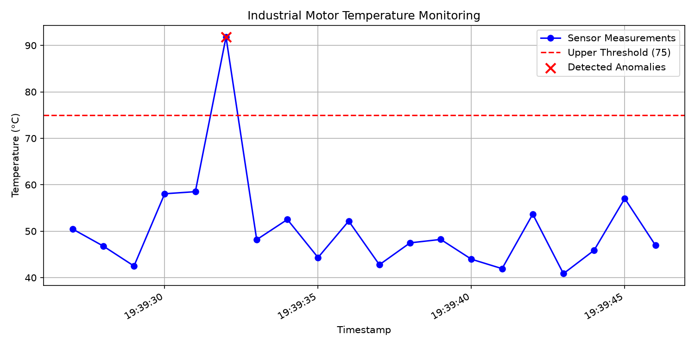
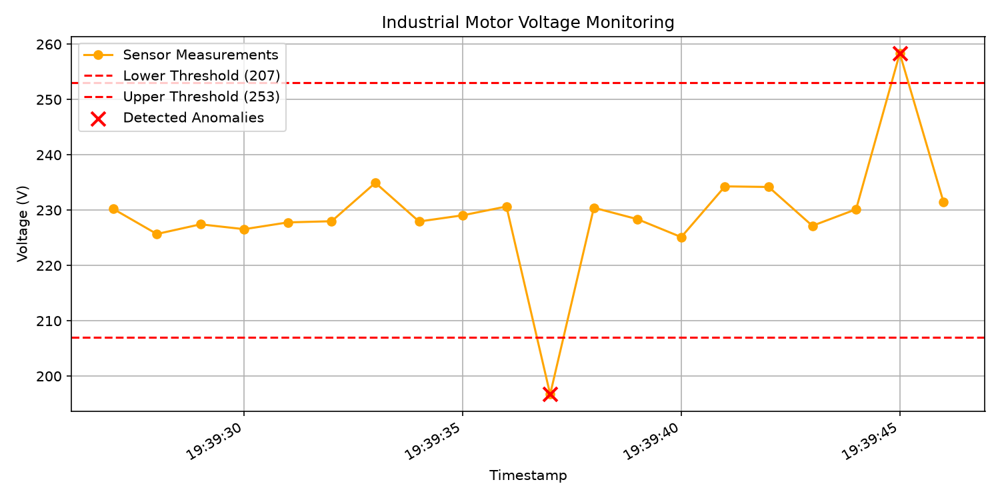
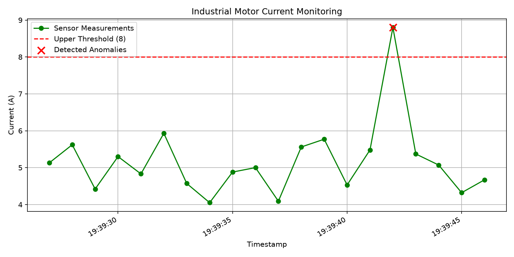

# Industrial Sensor Monitoring & Data Analysis

## Project Overview

A Python-based engineering application designed to simulate,
analyze, and visualize industrial sensor measurements.

The project demonstrates automated condition monitoring
using simulated data from a 230 V single-phase industrial
pump motor.

## Technologies Used

- Python 3
- Ubuntu Linux (WSL 2)
- Pandas
- Matplotlib
- Git and GitHub

## Implemented Features

- Simulated temperature, voltage, and current measurements
- Timestamped CSV dataset generation
- Sensor data validation
- Statistical analysis (minimum, maximum, average)
- Automatic operating threshold violation detection
- Engineering analysis report generation
- Sensor visualization with Matplotlib
- Automatic anomaly highlighting

## Simulated Operating Thresholds

| Parameter | Alarm Condition |
|-----------|-----------------|
| Temperature | Above 75 °C |
| Voltage | Below 207 V |
| Voltage | Above 253 V |
| Current | Above 8 A |

**Note:** All measurements and alarm limits are simulated
for software development and learning. They are not
validated protection settings for real industrial equipment.

## Project Development Status

- Phase 1: Development Environment — Completed
- Phase 2: Sensor Dataset — Completed
- Phase 3: Python Data Analysis — Completed
- Phase 4: Data Visualization — Completed
- Phase 5: Git and Documentation — In Progress
- Phase 6: CI/CD Pipelines — Planned


## Installation

### Prerequisites

- Python 3
- Git
- Ubuntu Linux or a compatible development environment
- pip and Python virtual environment support

### 1. Clone the Repository

```bash
git clone git@github.com:BaluBijubal/industrial-sensor-monitoring.git
```

### 2. Navigate to the Project Directory

```bash
cd industrial-sensor-monitoring
```

### 3. Create a Python Virtual Environment

```bash
python3 -m venv .venv
```

### 4. Activate the Virtual Environment

```bash
source .venv/bin/activate
```

### 5. Install Dependencies

```bash
python -m pip install -r requirements.txt
```

## Usage

Run all commands from the project root directory.

### 1. Generate Simulated Sensor Data

```bash
python src/generate_sensor_data.py
```

Creates the sensor dataset:

`data/sensor_data.csv`

### 2. Analyze Sensor Measurements

```bash
python src/analyze_sensor_data.py
```

Performs data validation, statistical calculations,
and operating threshold violation detection.

Generates the engineering analysis report:

`reports/sensor_analysis_report.txt`

### 3. Generate Sensor Visualizations

```bash
python src/visualize_sensor_data.py
```

Generates the following plots:

- `reports/temperature_plot.png`
- `reports/voltage_plot.png`
- `reports/current_plot.png`

The plots display sensor measurements, alarm
thresholds, and automatically highlighted anomalies.


## Project Structure

```text
industrial-sensor-monitoring/
├── data/
│   └── sensor_data.csv
├── src/
│   ├── generate_sensor_data.py
│   ├── analyze_sensor_data.py
│   └── visualize_sensor_data.py
├── reports/
│   ├── sensor_analysis_report.txt
│   ├── temperature_plot.png
│   ├── voltage_plot.png
│   └── current_plot.png
├── .gitignore
├── requirements.txt
└── README.md
```


## Sensor Data Visualizations

The application generates engineering plots for
temperature, voltage, and current measurements.

Each graph displays simulated sensor readings,
configured operating thresholds, and automatically
highlighted abnormal conditions.

### 1. Motor Temperature Monitoring

The temperature graph displays motor temperature
measurements and the simulated overheating threshold
of 75 °C.



### 2. Motor Supply Voltage Monitoring

The voltage graph displays supply voltage measurements
with undervoltage and overvoltage thresholds
of 207 V and 253 V, respectively.



### 3. Motor Current Monitoring

The current graph displays motor current measurements
and the simulated overcurrent threshold of 8 A.



### Anomaly Detection

The application automatically highlights measurements
that violate the configured operating thresholds.

For the included sample dataset:

- Temperature anomalies: 1
- Voltage anomalies: 2
- Current anomalies: 1
- Total abnormal measurements: 4

All measurements and thresholds are simulated
for engineering software development.


### Source Code

- `generate_sensor_data.py`: Generates simulated temperature,
  voltage, and current measurements and saves them to CSV.
- `analyze_sensor_data.py`: Validates sensor measurements,
  calculates statistics, detects threshold violations,
  and generates an engineering analysis report.
- `visualize_sensor_data.py`: Uses Pandas and Matplotlib
  to visualize measurements, operating thresholds,
  and abnormal conditions.

### Data and Reports

- `data/`: Contains the simulated sensor dataset.
- `reports/`: Contains the generated analysis report
  and sensor visualization images.

### Project Configuration

- `requirements.txt`: Lists Python package dependencies.
- `.gitignore`: Excludes local environment files and caches.
- `README.md`: Documents the project and its usage.

## Important Notes

- Measurements are simulated, not acquired from physical sensors.
- Running the generator overwrites the existing CSV dataset.
- Generated sensor values can differ between executions.
- Alarm thresholds are illustrative and must not be used as real equipment protection settings.


## Automated Testing

The application uses pytest to verify the reliability
of sensor monitoring and analysis functions.

The test suite covers:

- Normal and abnormal sensor operating conditions
- Overheating detection
- Under-voltage and over-voltage detection
- Overcurrent detection
- Alarm threshold boundary conditions
- Multiple simultaneous sensor faults
- Minimum, maximum, and average calculations
- Empty-dataset error handling
- Sensor data validation
- Missing and invalid measurement values
- Invalid timestamps and non-finite values

### Running Tests Locally

Activate the project's Python virtual environment.

Then execute:

```bash
python -m pytest -v
```

The current test suite contains 18 automated tests.


## Continuous Integration — GitLab CI/CD

The project uses GitLab CI/CD to automatically execute
the Python test suite whenever changes are pushed
to the GitLab repository.

The pipeline is configured in `.gitlab-ci.yml`.

### Pipeline Workflow

1. A commit is pushed to the GitLab repository.
2. GitLab starts the automated testing pipeline.
3. A Python 3.14 container is prepared.
4. Project dependencies are installed from
   `requirements.txt`.
5. pytest executes the automated tests.
6. GitLab reports the pipeline result.

### CI/CD Configuration

The pipeline uses:

- GitLab CI/CD
- Python 3.14
- pytest
- pip
- GitLab Runner

The initial GitLab CI/CD pipeline completed successfully.

### Repository Links

- [GitHub Repository](https://github.com/BaluBijubal/industrial-sensor-monitoring)
- [GitLab Repository](https://gitlab.com/BaluBijubal/industrial-sensor-monitoring)
